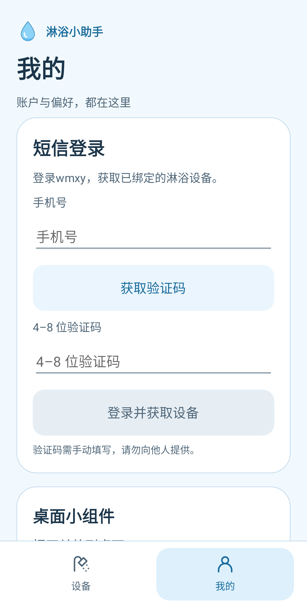
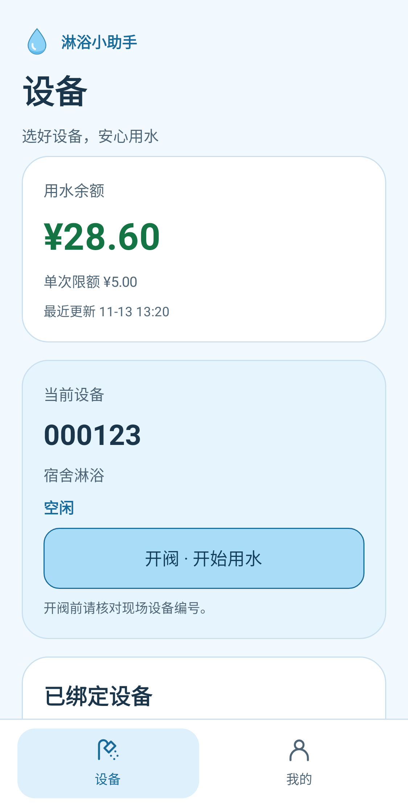
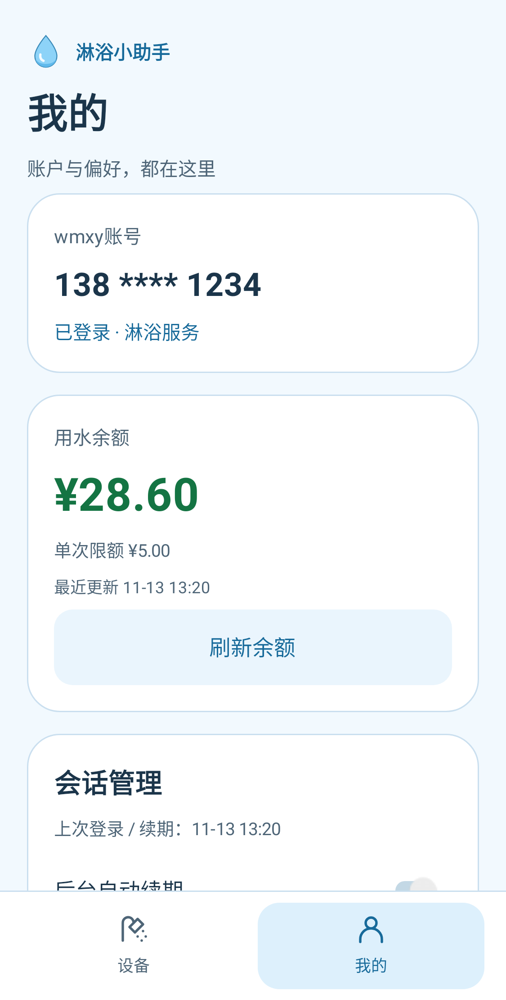
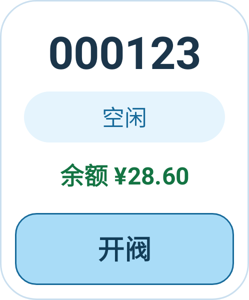
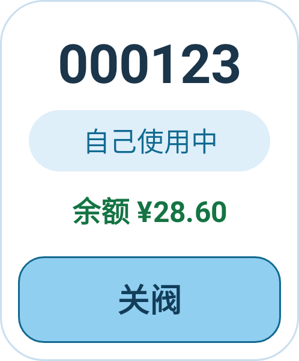
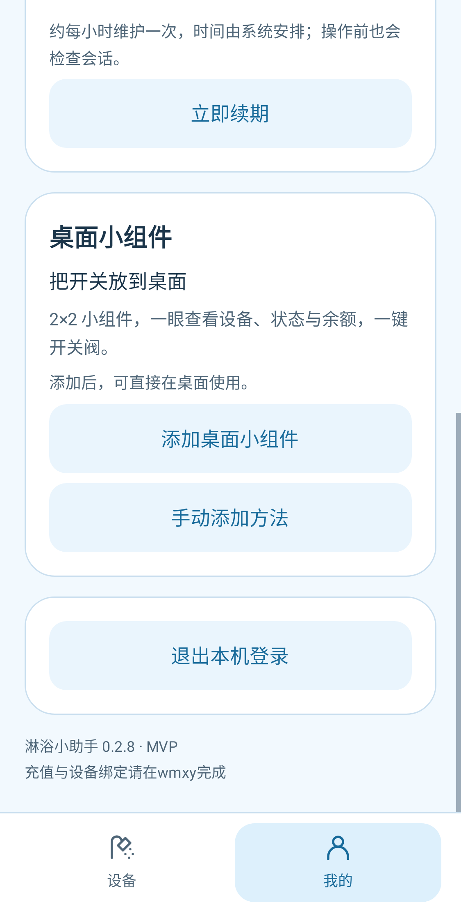

# 淋浴小助手

面向 GUET 校园淋浴场景的独立 Android 应用。把淋浴开关放到桌面：通过 **2×2 小组件快捷开水、关水**，同时查看设备状态和用水余额，省去每次打开 wmxy、等待烦人开屏广告的步骤。

应用支持短信登录、选择已绑定设备、查询余额和开关阀，无广告，无需电脑服务或 root。这是社区维护的非官方客户端，与 wmxy 及其运营方无隶属关系；当前仍为 MVP，支持范围受设备和服务端接口影响。

## 使用前提

使用淋浴小助手前，请先在 **wmxy APP** 中完成以下三项：

1. **注册并登录 wmxy 账号**，确认能接收该账号手机号的短信验证码。
2. **绑定 GUET 校园卡**。
3. **扫描寝室里对应淋浴设备的二维码，完成设备绑定**，确认在 wmxy 中能看到该设备。

淋浴小助手会读取此账号已经绑定的淋浴设备。注册、校园卡绑定、扫码绑定及充值仍需在 wmxy 中完成。

## 界面预览

<table>
  <tr>
    <th>短信登录</th>
    <th>设备与余额</th>
    <th>我的</th>
  </tr>
  <tr>
    <td></td>
    <td></td>
    <td></td>
  </tr>
</table>

| 桌面小组件：开水 | 桌面小组件：关水 |
| --- | --- |
|  |  |

图片由当前应用页面和小组件的原生视图生成，使用模拟账号、设备及余额。小组件示例展示组件本身；桌面留白和尺寸随启动器而异。

## 下载与安装

在本仓库的 [Releases](https://github.com/bbbstyyy/linyu/releases) 页面下载 `shower-helper-<版本>.apk`，支持 Android 8.0（API 26）及以上，目标 Android 16（API 36）。带版本后缀的构建会标为预发布。

Release 同时提供 `SHA256SUMS`（文件校验值）和 `SIGNING_CERT.txt`（签名证书指纹）。仓库不保存预编译 APK。首次发布前，Releases 中可能尚无下载。

已有开发签名版本的用户：正式签名与开发签名不同时，Android 不允许直接覆盖安装。请先在现场确认已停水，再卸载旧版、安装正式版、重新登录并添加小组件。卸载会清除本地账号和设置。后续正式版本使用同一密钥签名，且版本号递增时可覆盖升级。

## 使用教程

### 1. 登录账号

安装并打开淋浴小助手，切换到底部 **「我的」** 页。输入已在 wmxy 注册的手机号，点击 **「获取验证码」**，手动填写收到的短信验证码，再点击 **「登录并获取设备」**。应用无需读取短信权限。

### 2. 选择寝室设备

切换到 **「设备」** 页，点击 **「刷新设备与余额」**，在「已绑定设备」列表中选择寝室的淋浴设备。核对设备编号与现场二维码上的编号一致；编号中的前导零也需核对。

若列表为空，回到 wmxy 检查 GUET 校园卡和寝室淋浴设备是否已经绑定，再返回刷新。余额也可在「我的」页单独刷新。

### 3. 添加桌面小组件

在 **「我的」** 页向下滑动，找到「桌面小组件」，点击 **「添加桌面小组件」**，按照桌面提示确认添加。若启动器没有弹出添加窗口，长按桌面空白区域，打开「小组件」，找到「淋浴小助手」并拖到桌面，留出至少 **2×2** 的空间。



所有小组件共享当前账号和所选设备；需要换设备时，先关水，再回到应用的「设备」页选择。

### 4. 从桌面开水、关水

使用前核对小组件上的设备编号和状态。设备空闲时，点击 **「开阀」** 开始用水；用水结束时，点击 **「关阀」**，并在现场确认已经停水。应用内也可使用 **「开阀 · 开始用水」** 和 **「关阀 · 结束用水」** 操作。

日常开关水直接使用桌面小组件即可，无需每次打开 wmxy 等待开屏广告。点击小组件上方的设备编号或状态可进入应用。小组件显示最近一次查询结果，控制前会重新校验；点击按钮会影响真实水流和计费。

### 状态与常见问题

余额高于单次限额时显示绿色，否则显示红色；未知余额显示 `--`。**低余额不会阻止开阀。** 控制超时或结果不明时保留「关阀」入口，禁止再次开阀和切换设备；请以现场水流为准。

| 情况 | 处理方式 |
| --- | --- |
| 没有显示设备 | 在 wmxy 确认注册、GUET 校园卡绑定及寝室设备扫码绑定均已完成，再刷新列表 |
| 设备显示「他人使用中」 | 等待对方结束，核对是否选中了自己的寝室设备 |
| 账号登录失效 | 到「我的」页按提示退出本机登录，再获取短信验证码重新登录 |
| 小组件信息没有及时更新 | 点击小组件上方进入应用，刷新设备与余额；后台续期可能受系统省电限制 |
| 操作结果未确认 | 检查现场水流，使用保留的「关阀」入口结束用水；不要反复点击开阀 |

## 功能与范围

- 独立短信登录、手动续期和默认每小时的后台会话维护；后台执行可能受系统省电限制。
- 已绑定设备选择，空闲、本账号使用中、他人使用中、故障及结果未确认状态。
- 余额查询、开阀预检、关阀和异步结果确认；控制请求不会自动重发，应用重启后不会重放阀门操作。
- 2×2 桌面小组件、明暗主题、系统字号适配和浅蓝水滴图标。

目前仅支持已实现的 `wx` 联网淋浴分支。充值、新设备绑定、学校选择、风控挑战、代扣签约与待扣费处理请使用 wmxy。暂不支持蓝牙控制，也不保证所有学校和设备兼容。

离线检查覆盖核心状态机、加密、会话恢复、重复操作、窗口启动和小组件添加反馈。已有 Android 8 与 Android 16 的启动及界面验证；这些检查不代表所有机型、学校或完整真实用水流程已经验收。

## 隐私与安全

账号状态由 Android Keystore 加密保存在应用私有目录，关闭系统备份及设备迁移；不申请读取短信、通讯录或位置的权限。应用直接通过 HTTPS 连接相关服务，不设中转服务器，不包含广告或统计 SDK。详见 [隐私说明](docs/PRIVACY.md)。

源码中的服务地址、兼容元数据和固定协议参数是客户端实现的一部分，不是用户凭据。仓库不包含账号会话、签名私钥或设备现场数据。

## 自行构建

需要 JDK 21、Android SDK Platform 36 和 Build Tools 36.0.0。工程自带 Gradle 8.13 Wrapper，使用 AGP 8.13.2、Kotlin 2.2.21。

```bash
# 设置 ANDROID_HOME，或用 Android Studio 配置本机 SDK。
bash gradlew :app:assembleDebug

# 不连接真实账号或设备的应用测试与静态检查。
bash gradlew :app:verifyMvp :app:testDebugUnitTest :app:lintDebug :app:lintRelease

# 正式变体，此文件尚未签名，不能直接安装。
bash gradlew :app:assembleRelease
```

首次构建需联网下载 Gradle、SDK 和依赖；测试使用模拟传输，不访问真实业务接口。调试 APK 位于 `app/build/outputs/apk/debug/`。环境和界面预览见 [开发说明](docs/DEVELOPMENT.md)。

## 参与和发布

请阅读 [贡献说明](CONTRIBUTING.md)；问题反馈中不要附带真实账号或原始响应。安全问题见 [安全说明](SECURITY.md)。

GitHub Actions 在提交和 Pull Request 时检查公开文件范围、构建、运行测试和 Lint。推送与 `version.properties` 一致的 `v<版本>` 标签后，自动构建、验证、签名并创建 Release。首次配置见 [发布指南](docs/RELEASING.md)，版本记录见 [CHANGELOG](CHANGELOG.md)。

## 许可证

应用原创代码采用 [MIT License](LICENSE)。第三方依赖保留各自许可证，详见 [第三方声明](THIRD_PARTY_NOTICES.md)。相关品牌、服务及接口的权利归各自权利人所有。
